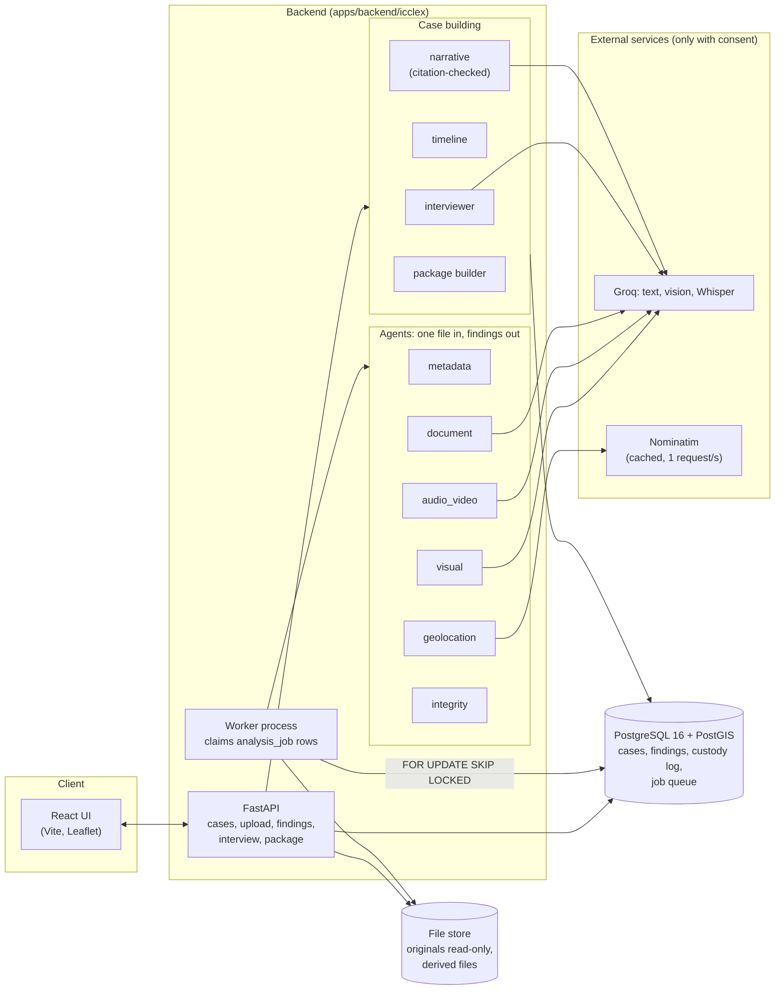
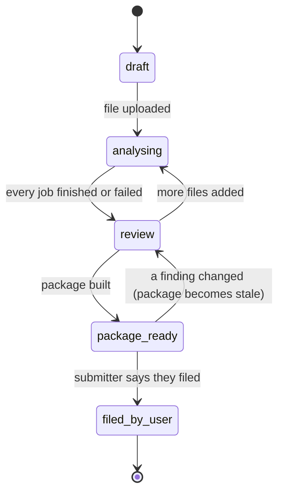
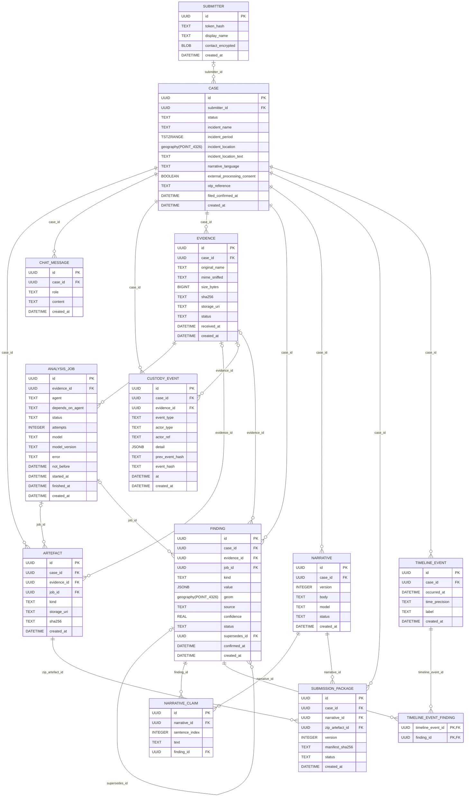

# ICCLexAI system design

What the system is: it helps a person turn their own evidence (photos, video, audio, documents) and
their account into a **package they file themselves on the ICC Prosecutor's OTPLink portal**. Agents
read each file, say what they found and how they know, and the person confirms, edits or rejects every
finding. Nothing is submitted for them: OTPLink has no public API and no published terms allowing
automation, so the system ends at a package and a checklist.

On 2026-11-05 the previous version ran every analysis step as a mock, replaced uploaded binaries with
the text `[Binary file: x]`, deleted the only copy of each file, and told users a case had been
submitted to the ICC when nothing was sent. The design below exists so none of that can recur.

## Rules the design enforces

| Rule | Where it is enforced |
|---|---|
| An original is never altered or lost | stored read-only, hashed while streaming; `evidence` hash/size/path are write-once (trigger); nightly re-hash (`verify.py`) |
| Every fact says where it came from | `finding.source` is `extracted` (read from the file), `inferred` (a model said so) or `stated` (the submitter); confidence exists only for `inferred` (check constraint) |
| The submitter confirms before anything is used | only `confirmed` or `edited` findings reach the narrative and package; a narrative claim citing anything else is rejected by the database |
| No legal conclusions | `narrative.py` drops sentences that state one and reports them; the agents are told not to |
| A model outage never produces invented output | agents raise `AgentUnavailable`; the job fails and the file shows "not analysed" |
| Content leaves the server only with consent | `case.external_processing_consent`; agents that call a model or geocoder refuse without it |
| The chain of custody cannot be quietly edited | `custody_event` is append-only and hash-chained (trigger + `custody.verify_chain`) |
| The tool never says it filed anything | the case reaches `filed_by_user` only when the submitter says so, and the log records that it is unverified |

## Components



Local-only agents (no consent needed): `metadata`, `integrity`, and the distance check inside
`geolocation`. The job queue is a table, so there is no Redis to run. Agents never write to the
database; the worker validates what they return and stores it with the job, model and version in one
transaction.

## Request flow

```mermaid
sequenceDiagram
    actor U as Submitter
    participant UI as React UI
    participant API as FastAPI
    participant OBJ as File store
    participant DB as PostgreSQL
    participant W as Worker
    participant AG as Agents
    U->>UI: add a file
    UI->>API: POST /cases/{id}/evidence (stream)
    API->>OBJ: write original, SHA-256 while streaming, read-only
    API->>DB: evidence + custody_event(received) + analysis_jobs
    API-->>UI: evidence id and sha256
    W->>DB: claim a job (SKIP LOCKED; waits for its dependency)
    W->>OBJ: read the original
    W->>AG: run the agent
    AG-->>W: findings (extracted / inferred) or AgentUnavailable
    W->>DB: findings, job result, custody_event(analysed)
    UI->>API: poll
    U->>UI: confirm / edit / reject findings
    UI->>API: PATCH /findings/{id}
    API->>DB: finding status (an edit is a new row), custody_event
    U->>UI: describe the incident
    API->>DB: stated findings; date conflicts put to the submitter
    U->>UI: build package
    API->>DB: timeline, narrative + claims, package, custody_event
    API-->>UI: package ready
    U->>UI: download and file on OTPLink
    U->>UI: "I filed it" (optional reference)
    API->>DB: status filed_by_user (reported, not verified)
```

## Case lifecycle



## Data model

Generated from the tables by `python -m icclex.erd`; `tests/test_erd_doc.py` fails if this block and
the schema disagree. Fact rows are never overwritten: an edit adds a finding whose `supersedes_id`
points at the old one, and the old one becomes `superseded`.

<!-- erd:start -->

<!-- erd:end -->

Changes from the first design, made while building:
- `finding.status` gains `superseded`, and `finding.kind` gains `device` and `file_properties`.
- `analysis_job.depends_on_agent`: geolocation and integrity read the metadata agent's findings, so the queue holds them back until it finishes.
- `case.external_processing_consent`, `case.incident_location_text` and `case.narrative_language`.
- A `timeline_event.time_precision` of `exact`, `day`, `month` or `unknown`.

Database guarantees (migration `0002_integrity_triggers`): evidence hash, size, path and case are
write-once; `custody_event` refuses UPDATE, DELETE and TRUNCATE, and `(case_id, prev_event_hash)` is
unique so the chain cannot fork; a finding's content cannot be rewritten, only its review status;
a narrative claim must cite a confirmed or edited finding.

## Known limits

- **OTPLink fields are provisional.** `docs/otplink-field-map.md` records what is and is not verified. A person has to walk through the live form before the field text can be relied on.
- **No tamper or AI-image detector.** The integrity agent compares metadata and raises flags ("worth checking"); it cannot show a file is authentic or fake.
- **Metadata stripping** is lossless and covers JPEG and PNG only. Other types go in unchanged and the package says so.
- **The last custody event can be deleted only by disabling the trigger**, and the chain would still verify, because the log stores no external anchor for its tip. Anchoring the tip outside the database (for example in the package manifest of a case already handed over) is not built.
- **Translation and OCR beyond what the vision model copies** are not built; OTPLink is English only.
- **One server, local disk.** The storage interface (`storage.py`) is the seam for S3-compatible storage.
